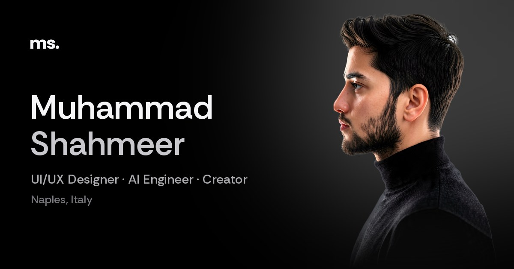

# m-shahmeer-kz.github.io

My personal portfolio website, designed and hand-built by me. No templates and no website builder.

🔗 **Live:** https://m-shahmeer-kz.github.io/

## ✨ Features

- **Liquid-glass design:** frosted glass panels, silver gradient type and a custom "ms." brand mark
- **Liquid cursor:** a bubble that bends the page behind it like a lens, built with an SVG displacement filter
- **Smooth scrolling** with Lenis, plus scroll-driven animations (stacked project cards, words that light up, 3D tilt)
- **5 case studies** in accessible pop-ups (problem → process → key decision → results)
- **English / Italian** switch for every piece of text, chosen automatically from the visitor's browser language
- **Certificates** with verification links and a built-in viewer
- **Privacy-friendly:** Instagram reels load only after the visitor taps (no third-party cookies before consent)
- **Contact form** that opens the visitor's email app with the message ready
- **Fully responsive**, tested on 13 screen sizes from iPhone SE to 2560 px monitors

## 📊 Quality (Google Lighthouse)

| | Mobile | Desktop |
|---|---|---|
| Performance | 91 | 100 |
| Accessibility | 100 | 100 |
| SEO | 100 | 100 |

## 🛠️ Built with

- HTML, CSS and vanilla JavaScript (no framework)
- [Lenis](https://github.com/darkroomengineering/lenis) for smooth scrolling
- Rethink Sans from Google Fonts
- Structured data (schema.org `Person`) and Open Graph tags for search and link previews
- Hosted on GitHub Pages

## 📁 Files

| File | Purpose |
|---|---|
| `index.html` | The whole website: layout, styles, scripts and both languages |
| `hero.webp`, `side.webp`, `front.jpg`, `gym.jpg` | Portraits and section photos |
| `dp1.jpg`, `dp2.jpg` | Instagram profile pictures |
| `cv.pdf` | Downloadable CV |
| `cert-navttc.jpg`, `cert-stevta.jpg` | Certificate images (ID numbers blurred) |
| `og-image.jpg` | Link-preview image for LinkedIn, WhatsApp and others |

---

© Muhammad Shahmeer · [LinkedIn](https://www.linkedin.com/in/muhammad-shahmeer-337088338/) · [Instagram](https://www.instagram.com/ig.shahmeer/)
